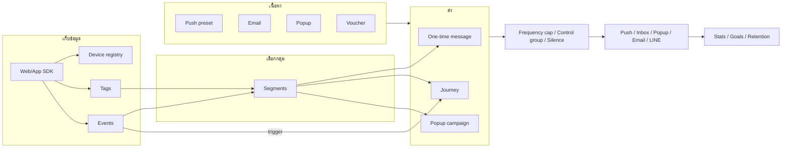

# Pushwoosh feature spec — ต้นแบบสำหรับสร้างระบบของเราเอง

- **ที่มา:** ลองใช้ Pushwoosh จริงในโปรเจกต์ `joshcje` เมื่อ 2026-10-10
- **ผลเทสละเอียด:** ดู [2026-10-10-pushwoosh-features.md](2026-10-10-pushwoosh-features.md)
- **เนื้อหา:** แต่ละ feature มี 3 ส่วน: **ทำอะไร** · **ตั้งค่าได้** · **กฎการทำงาน** (พฤติกรรมที่เห็นตอนลองจริง)
- **Priority:** P0 = ต้องมีถึงจะใช้งานได้, P1 = ทำให้ automation ใช้ได้จริง, P2 = เสริม

---

## โครงสร้างระบบโดยรวม

---

## 1. Platform & การสมัครรับแจ้งเตือน

### 1.1 Web push setup — P0
- **ทำอะไร:** เปิดช่องทาง web push ให้โปรเจกต์
- **ตั้งค่าได้:**
  - สร้าง key ใหม่ให้อัตโนมัติ หรือใช้ key เดิมที่มีอยู่
  - ปิด platform ได้
  - มีหน้า "Get the code" ให้ snippet สำเร็จรูป
- **กฎการทำงาน:**
  - หน้าเว็บต้องมี script ของ SDK และไฟล์ service worker ที่ root ของโดเมน
  - Journey ที่มี push node จะ Validate ไม่ผ่าน ถ้ายังไม่เปิด push platform สักตัว

### 1.2 Device registry (HWID) — P0
- **ทำอะไร:** ทุก browser/device ที่ subscribe ได้ ID เฉพาะ (รูปแบบ `<appCode>_<uuid>`)
- **กฎการทำงาน:**
  - ได้ HWID ตั้งแต่โหลด SDK ครั้งแรก แม้ยังไม่ให้สิทธิ์แจ้งเตือน
  - Browser ที่บล็อกแจ้งเตือนก็ยังได้ HWID ที่ใช้รับ popup ได้ แต่รับ push ไม่ได้
  - หน้าโปรเจกต์แสดง "Enabled devices / Total devices"

### 1.3 Auto tags ตอน subscribe — P0
- **ทำอะไร:** ระบบเติมข้อมูล device ให้เองโดยไม่ต้องเขียนโค้ด
- **ค่าที่ได้:** Country, City (จาก IP), Language, Timezone, Browser Type, Device Model, Platform, SDK Version, First Install, Last Application Open, Push Alerts Enabled
- **กฎการทำงาน:** ใช้ทำ segment ได้ทันทีหลัง subscribe (เทสแล้ว: Country=TH เจอ 1 device)

### 1.4 Subscription bell — P1
- **ทำอะไร:** ปุ่มกระดิ่งลอยบนเว็บ ให้ผู้ใช้กดสมัคร
- **ตั้งค่าได้:**
  - ตำแหน่ง 4 มุม หรือใช้รูปของเราแทนกระดิ่ง
  - ขนาด, สีพื้น, สีไอคอน
  - tooltip ปกติ และ tooltip ตอนถูกบล็อก
- **กฎการทำงาน:**
  - ซ่อนเมื่อผู้ใช้ subscribe แล้ว
  - ถ้าผู้ใช้บล็อกแจ้งเตือน จะเปลี่ยนเป็นไอคอนบล็อก
  - กดแล้วเปิด invitation (ถ้าเปิดไว้) หรือขอ permission ทันที

### 1.5 Subscription invitation — P1
- **ทำอะไร:** การ์ดชวน subscribe ก่อนเด้ง permission ของ browser (soft-ask)
- **ตั้งค่าได้:**
  - layout แบบ Card, Bar หรือ Window กลางจอ
  - ตำแหน่ง 6 แบบ และ icon
  - เปิดได้ 3 แบบ: อัตโนมัติหลังโหลด, เมื่อกดกระดิ่ง หรือจากโค้ด
  - delay (วินาที), แสดงสูงสุดกี่ครั้ง, ห่างกันกี่ชั่วโมง
  - ข้อความ: title, message, ปุ่ม Allow/Decline และชุดข้อความแยกตอนถูกบล็อก
  - สี 4 ค่า มี preview 2 สถานะ (ยังไม่ตัดสินใจ / บล็อกแล้ว)
- **กฎการทำงาน:**
  - ถ้าผู้ใช้บล็อกไว้ จะแสดงวิธีเปิดสิทธิ์ใน browser แทนปุ่ม Allow
  - ค่าที่ตั้งในหน้า admin มีผลภายใน 1 นาทีโดยไม่ต้องแก้ snippet

---

## 2. ข้อมูลผู้ใช้

### 2.1 User ID (registerUser) — P0
- **ทำอะไร:** ผูก device เข้ากับ ID ลูกค้าของเรา
- **กฎการทำงาน:**
  - 1 user มีได้หลาย device
  - ส่งข้อความหา user ID ได้โดยตรง และเลือกได้ว่าจะส่งทุก device หรือเฉพาะ device ล่าสุด
  - payload ของ push แนบ `user_id` มาด้วย

### 2.2 Tags — P0
- **ทำอะไร:** attribute ของผู้ใช้ เช่น ชื่อ, tier, จังหวัด
- **ชนิดข้อมูล:** String, Integer, Decimal (price), Boolean, List, Date, Version, Timezone
- **กฎการทำงาน:**
  - ตั้งจาก SDK (`setTags`), จาก journey (Update User Profile), จาก webhook (Response mapping) หรือ import CSV
  - ใช้ได้ทั้งใน segment และ personalization ด้วย Liquid (`{{first_name|default:'ลูกค้า'}}`)

### 2.3 Events — P0
- **ทำอะไร:** พฤติกรรมผู้ใช้ เช่น ดูสินค้า, ซื้อ
- **ตั้งค่าได้:** ชื่อ event, คำอธิบาย และ attribute หลายตัวที่กำหนดชนิดได้
- **กฎการทำงาน:**
  - ต้องสร้าง event ในหน้า admin ก่อนยิงจาก SDK
  - พอสร้างแล้วระบบโชว์โค้ด SDK ให้ทันที (JS / Swift / ObjC / Java)
  - หน้า list แสดง activity 7 วันต่อ event
  - มี system event อัตโนมัติ: `PW_DeviceRegistered`, `PW_ApplicationOpen`, `PW_ScreenOpen`, `PW_PopupFormImpression`, `PW_PopupFormVisit`
  - ใช้เป็น trigger ของ journey, เงื่อนไข segment, conversion goal และ retention ได้
  - มี "Conversion events tracking" สำหรับ map event เข้ากับ revenue

### 2.4 Segments — P0
- **ทำอะไร:** กลุ่มผู้ใช้ตามเงื่อนไข
- **ตั้งค่าได้:**
  - filter ด้วย Tag, Event, Segment อื่น, User ID หรือ Location radius
  - operator ของ string: is, is not, starts with, ends with, contains, in, not in, not set, any
  - ซ้อน group (AND/OR) ได้เหมือนวงเล็บ
  - "Include all of a user's devices": ถ้า device ไหนของ user ตรงเงื่อนไข ให้รวมทุก device ของ user นั้น
- **กฎการทำงาน:**
  - ตอนสร้างแสดง estimated size แยกตามช่องทาง (push, web, email, SMS, WhatsApp, LINE, Kakao, Telegram, Viber)
  - หลังบันทึกต้องกด Refresh ถึงจะคำนวณขนาดจริง (unique users + devices ตามช่องทาง)
  - มี segment ตั้งต้นให้ (new users, inactive 3/7 วัน, purchased, push enabled, all)

### 2.5 Import / ข้อมูลภายนอก — P2
- **Import CSV:** tag values, push subscribers, events, contacts (email / phone / WhatsApp / Viber), subscription categories
- **External segments:** ดึง audience จาก PostgreSQL / MySQL / BigQuery / SQL Server
- **RFM:** คำนวณ R/F/M จาก purchase event และ monetary attribute
- **User Explorer:** ค้นดูผู้ใช้รายคนด้วย user ID

---

## 3. Content

### 3.1 Push preset — P0
- **ทำอะไร:** เนื้อหา push ที่นำไปใช้ซ้ำได้หลาย campaign
- **ตั้งค่าได้:**
  - title, subtitle, message และหลายภาษา
  - รูป/GIF
  - on-click: หน้าแรก / URL / deep link
  - custom JSON data
- **ตัวช่วย:** AI composer, AI translate, Fill from link, Validate Liquid
- **กฎการทำงาน:**
  - มีสถานะ approval และ version (เช่น `APPROVED · V1`)
  - preview 4 OS (iOS / Android / macOS / Windows)
  - ปุ่ม "Test push" ส่งหา Test Devices ทั้งหมด พร้อมบอกว่าจะส่งกี่เครื่อง
  - ถ้า Liquid ไม่มี default และไม่มีค่า push อาจถูกข้ามในบาง flow (ระบบขึ้นเตือนไว้)
- **ประเภทอื่น:** Product recommendations, News feed, Push stories

### 3.2 Email content — P1
- **ทำอะไร:** ออกแบบอีเมลแบบลากวาง block
- **ตั้งค่าได้:**
  - template กว่า 20 แบบ (welcome, promo, abandoned cart, order confirmation, win-back, birthday ฯลฯ)
  - subject และ preheader (มี AI ช่วยเขียน)
  - Liquid, หลายภาษา (export/import CSV)
  - preview mobile และ dark mode
- **กฎการทำงาน:**
  - **Smart check** ตรวจก่อนบันทึก: ปุ่มไม่มีลิงก์, ไม่มีที่อยู่ CAN-SPAM, preheader ว่าง
  - spam score และ link check ทำตอน test send ใน campaign
  - ช่องทาง email ใช้ได้หลังผ่าน verification บัญชีและยืนยันโดเมน (DNS)

### 3.3 Web popup — P1
- **ทำอะไร:** popup บนเว็บสำหรับโปรโมชั่น, ฟอร์ม, ขอ opt-in
- **template:** flash sale, mega sale, modal + รูป, newsletter form, product tour หลายหน้า, cookie bar, side panel, ขอเปิดแจ้งเตือน, paywall ฯลฯ
- **editor:**
  - หลายหน้า
  - element: Text, Button, Icon, Countdown, Topic picker, Rating, Subscription form
  - ตั้งสี, dark theme, ตำแหน่ง, overlay, มุมโค้ง, เงา และ animation (fade/slide)
- **กฎการทำงาน:** ยิง event `PW_PopupFormImpression` และ `PW_PopupFormVisit` อัตโนมัติ

### 3.4 Inbox — P1
- **ทำอะไร:** กล่องข้อความในเว็บหรือแอป เก็บข้อความไว้ให้กลับมาอ่าน
- **กฎการทำงาน:**
  - ข้อความเข้า inbox เมื่อเปิด "Save to inbox" ใน push หรือ one-time message (เก็บ 1 วันโดยค่าเริ่มต้น)
  - widget บนเว็บเปิดจากปุ่มที่มี id ที่กำหนด (`#pwInbox`)
  - มี badge นับข้อความยังไม่อ่าน, จุด unread, เวลา และปุ่มลบ
  - ข้อความใน inbox ยังเห็นได้แม้ถูก frequency cap

### 3.5 Vouchers — P2
- **ทำอะไร:** pool โค้ดส่วนลดที่แจกโค้ดไม่ซ้ำให้แต่ละคน
- **ตั้งค่าได้:** อัปโหลด CSV (คอลัมน์ `vouchers`), ชื่อ pool, วันหมดอายุ
- **กฎการทำงาน:**
  - หน้า list แสดงจำนวนโค้ดที่เหลือเทียบทั้งหมด
  - push node มีสวิตช์ "Use Vouchers" ไว้ใส่โค้ดในข้อความ

### 3.6 Deep links — P2
- **ทำอะไร:** template ลิงก์เข้าแอปแบบมีพารามิเตอร์ เช่น `josh://product/{sku}/` ไว้เลือกใช้ใน preset

### 3.7 อื่น ๆ — P2
- Media storage (รับรูปจาก Figma plugin ได้)
- Cloud Pages
- Product Catalog (feed หรือ CSV สำหรับ recommendation)
- News feeds (RSS เข้า email ทุกชั่วโมง)
- In-app HTML (แอปมือถือ)
- Messenger presets (SMS / LINE / Kakao + ย่อลิงก์)

---

## 4. การส่ง

### 4.1 One-time message — P0
- **ทำอะไร:** ส่งครั้งเดียวแบบ wizard 4 ขั้น
- **ขั้นตอน:**
  1. **Content:** เลือก preset, ประเภท Marketing/Transactional, Save to inbox
  2. **Audience:** segment / user ID ที่ระบุ / ทุกคน, เลือก platform, ส่งเฉพาะ device ล่าสุด
  3. **Sending time:** ทันที / ตั้งเวลา / Best time
  4. **Review:** สรุปทุกอย่าง → ใส่ชื่อ campaign → ยืนยันส่ง
- **กฎการทำงาน:**
  - การกด "Test push" จาก preset ก็ถูกบันทึกเป็น one-time message ด้วย
  - หน้า list กรองตามช่องทาง, วันที่ และ marketing/transactional ได้ แสดง status / sent / errors

### 4.2 Journey builder — P1 (หัวใจของระบบ)
- **ทำอะไร:** automation แบบ canvas ลากวาง
- **การใช้งานบน canvas:**
  - ลาก node ลง canvas แล้วลากเส้นเชื่อม
  - ดับเบิลคลิกเพื่อตั้งค่า ระบบบันทึก draft อัตโนมัติ
  - node ที่ยังตั้งค่าไม่ครบมีจุดแดง
- **เมนูของ journey:** Save, Rename, Clone, Validate, Launch
- **กฎการทำงาน:**
  - "Build from scratch" สร้าง draft ทันที
  - Validate บอก error เป็นข้อ ๆ
  - Launch แล้วแก้ไขได้หลัง pause
  - payload ของ push จาก journey มี marker บอกว่ามาจาก journey ไหน (`isCJMessage`, point id)

**Entry nodes**

| Node | ตั้งค่าได้ |
|---|---|
| Audience-based | segment, one-time หรือ recurring, ส่งทันทีหรือตั้งวัน, คนเดิม / คนเดิม+ใหม่ / คนใหม่ |
| Trigger-based | event + เงื่อนไข attribute, ช่วงเวลาที่เปิดรับ, 1 session ต่อ user หรือหลาย session (แยกด้วย attribute ที่ไม่ซ้ำ), อนุญาตให้เข้าซ้ำ (เข้าซ้ำ = เริ่ม session ใหม่) |
| API-based | เริ่ม journey จาก API ส่ง placeholder ไปใช้ในข้อความได้ |

**Flow nodes**

| Node | ตั้งค่าได้ |
|---|---|
| Time Delay | fixed duration / specific time / date / day of week / ตามข้อมูล user หรือ event (สูงสุด 30 วัน) |
| Wait for Trigger | รอ event หลาย branch, timeout สูงสุด 90 วัน, branch "Not triggered", fixed waiting period (รอครบเวลาแม้ event เกิดก่อน) |
| Condition Split | แยกตาม segment (ใช่/ไม่ใช่), tag (หลาย branch) หรือ event attribute, เลือกเช็กทุก device หรือเฉพาะ device ที่เข้ามา |
| A/B/n Split | สัดส่วนแต่ละ branch, เลือกผู้ชนะเองหรือให้ระบบเลือกตาม goal แล้วปิด branch ที่แพ้ |
| Holdout Split | กันกลุ่มไว้ไม่ส่ง เพื่อวัดผล |
| Update User Profile | ตั้ง tag แบบใส่ค่าเอง หรือดึงจาก event attribute |
| Reachability Check, Loop, Audience sync | — |

**Channel nodes**
- Push: preset, Marketing/Transactional, personalize ด้วย event attribute, Use Vouchers, Save to inbox, TTL, frequency cap / send rate (ใช้ค่ากลางหรือ override), Best time, ส่งทุก device หรือ device ล่าสุด, split ตาม opened / delivered
- Email, In-App, SMS, WhatsApp, LINE, Kakao, Telegram, Viber, FB Messenger, App inbox, Live Activity, Wallet pass, Data to app
- **Multi-Armed Bandit:** แบ่ง traffic ไปหาตัวที่ดีกว่าอัตโนมัติ
- **Webhook:** URL, method, headers, JSON body + macro (`{{device:hwid}}`), **Response mapping** (ผลตอบกลับไปลง tag), ปุ่มทดสอบ

**Integration nodes:** CRM (HubSpot, Salesforce, Dynamics), DB (BigQuery, Snowflake, Supabase, Airtable, Fabric), AI (OpenAI, Gemini, LLM), Analytics (Amplitude, Mixpanel, Adjust, AppsFlyer), Apps (Google Sheets, Slack, Mattermost, Adapty)

**Journey settings**

| Setting | กฎการทำงาน |
|---|---|
| Conversion goals | event + ระยะเวลานับหลังออกจาก journey (สูงสุด 30 วัน), ใส่เงื่อนไข attribute ได้, "จบ journey เมื่อเกิด event นี้" |
| Cancel events | เอาผู้ใช้ออกจาก journey โดยไม่นับเป็น conversion |
| Silence period | ช่วงเวลาห้ามส่ง |
| Campaign Entry Limit | จำกัดจำนวนคนเข้า |

**ผลที่ยืนยันแล้ว (browse abandonment):**
- ดูสินค้าแล้วไม่ซื้อใน 1 นาที → ได้ push ใน 67 วินาที
- ซื้อทันที → ไม่ได้ push และนับเป็น goal
- หน้า stats แสดง Entrances 2, Goal 50%, Sent 1

### 4.3 Popup campaign — P1
- **ทำอะไร:** เลือก popup content มาแสดงตามเงื่อนไข
- **ตั้งค่าได้:**
  - audience: ทุกคน, segment หรือเงื่อนไข
  - เปิดได้แบบอัตโนมัติตอนโหลดหน้า หรือเรียกจาก SDK
  - delay (นับจาก SDK init), frequency (เช่น ครั้งเดียวต่อผู้เข้าชม)
  - device: all / desktop / mobile
  - หน้าที่จะแสดง: ทุกหน้าแต่ยกเว้นบางหน้า หรือเฉพาะหน้าที่ระบุ
- **กฎการทำงาน:**
  - status เป็น Draft / Active / Inactive
  - หน้า list แสดง Visitors และ Impressions
  - เปิดหรือปิด popup ทั้งเว็บได้จากหน้า platform settings

### 4.4 ช่องทางอื่น — P2
- Geo campaigns: geozone จาก address หรือหมุด, cluster แชร์ cooldown, ส่งตอนเข้าโซน
- Wallet passes
- Messenger chats: inbox แชต WhatsApp / LINE แบบ 2 ทาง

---

## 5. กฎการส่ง (Delivery rules)

### 5.1 Marketing vs Transactional — P0
- **Marketing:** เคารพ frequency cap และ silence period, ไม่ส่งหา global control group
- **Transactional:** ข้าม frequency cap, ส่งหา control group ด้วย
- **กฎการทำงาน:** บังคับเลือกใน one-time message และใน journey ที่เริ่มจาก event หรือ API (ถ้าไม่เลือก launch ไม่ได้)

### 5.2 Frequency capping — P1
- **ตั้งค่าได้:**
  - แยกช่องทาง (push / email / in-app / SMS / WhatsApp / inbox)
  - "สูงสุด N ข้อความต่อ X วัน" ค่าเริ่มต้น 5 ต่อ 1 วัน
  - นับแบบ rolling window หรือ calendar day
- **กฎการทำงาน:**
  - มีผลกับทุก campaign รวมถึงที่ส่งผ่าน API (ระบบเตือนก่อนเปิด)
  - **ยกเว้นผู้ใช้รายคนได้** ด้วย user ID หรือ email
  - แต่ละข้อความเลือกใช้ค่ากลางหรือ override ได้

### 5.3 Send rate — P2
- จำกัดความเร็วการส่ง แยกช่องทาง

### 5.4 Control groups — P1
- **ทำอะไร:** กันผู้ใช้ส่วนหนึ่งไม่ให้ได้ marketing message เลย เพื่อวัดว่าการส่งทำให้ยอดเพิ่มจริงไหม
- **ตั้งค่าได้:**
  - ขนาด 3% / 5% / 10% / กำหนดเอง
  - Permanent (กันถาวร), Auto-refresh (สุ่มใหม่ทุกรอบ), Experiment (มีวันเริ่ม-จบ)
  - จำกัดตามประเทศหรือ tag
- **รายงาน:** conversion ของ control เทียบ treatment, uplift, significance ต่อ goal event (สูงสุด 10 event), อัปเดตวันละครั้ง

---

## 6. Statistics

| Feature | แสดงอะไร |
|---|---|
| Project overview | MAU/DAU, สัดส่วน platform, channel reach, retention D1/7/14/28, export |
| Project statistics | subscribed users, recipients, DAD/MAD ตามช่วงเวลาและ platform |
| Dashboards | ตั้งต้นให้ 5 ตัว (Push, In-app, Events, Email, App); push dashboard มี Recipients, CTR, Sends, Deliveries, Opens, Installs, Uninstalls แยก platform; เพิ่ม chart เองได้ |
| Journey stats | entrances, in journey now, exits, sent / open rate ต่อช่องทาง, goal %, drop-offs, Find user path |
| Retention | เลือก event เริ่มต้นและ event ที่กลับมา ช่วง 7–31 วัน ได้ตาราง cohort รายวัน (<1 day, Day 1…6) |
| Aggregated messages | รวมหลาย campaign เป็นกลุ่มเพื่อดูผลระยะยาว |
| Popup stats | visitors, impressions |

---

## 7. ระบบหลังบ้าน

| Feature | ทำอะไร |
|---|---|
| Projects | หลายโปรเจกต์ต่อบัญชี แต่ละโปรเจกต์มี app code, list โปรเจกต์แสดง audience / new contacts / sent / opened 30 วัน |
| Test devices | เพิ่มด้วย QR หรือ HWID แยก push / email / SMS ใช้กับปุ่ม test ทุกที่ |
| API access | Device token (ฝั่ง client) และ Server token (ฝั่ง server) |
| Permissions | สิทธิ์ See / Modify / Send push แยกตามกลุ่ม |
| Email suppression | รายชื่อที่ bounce หรือร้องเรียน spam ระดับบัญชี export ได้ |
| Integrations | inbound webhooks, event streaming ออก, Figma และ analytics/IAP |
| AI Assistant | โหมดถามตอบ หรือ Full automation (ต้องยินยอมให้ประมวลผลข้อมูล) |

---

## ลำดับที่แนะนำถ้าจะสร้างเอง

| Phase | Feature | ใช้ทำอะไรได้ |
|---|---|---|
| **1 (P0)** | Web push setup, device registry, user ID, auto tags, tags, events, segments, push preset + test device, one-time message, marketing/transactional | ส่ง push หาคนหรือกลุ่มที่เลือกได้ |
| **2 (P1)** | Journey (trigger/audience entry, wait for trigger, delay, condition split, push node), conversion goals, frequency cap, inbox, bell + invitation, journey stats | browse/cart abandonment และ win-back อัตโนมัติ |
| **3 (P1)** | Popup campaign, A/B/n, control group + uplift, dashboards, retention | วัดผลว่าการส่งทำให้ยอดเพิ่มจริงไหม |
| **4 (P2)** | Email, LINE, vouchers, deep links, webhook + response mapping, RFM, import CSV, external segments | ขยายช่องทางและต่อกับระบบอื่น |
