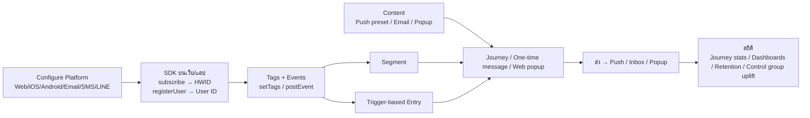
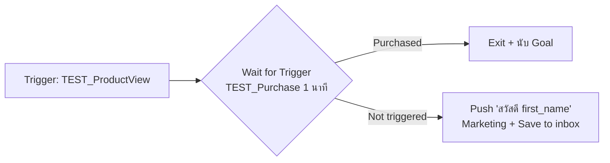

# Pushwoosh — สรุป feature และ flow (ลองใช้จริง)

- **วันที่:** 2026-10-10
- **บัญชี:** pongpanot0@gmail.com — โปรเจกต์ `joshcje` (`F9761-88B2F`)
  - ลิงก์ต้นทาง `86FC5-A2174` ไม่อยู่ในบัญชีนี้
- **สถานะเทส:** ✅ = ลองแล้วได้ผล, 🔧 = สร้างหรือตั้งค่าได้แต่ยังไม่ได้ส่ง/ยิงจริง, 👀 = เปิดดูอย่างเดียว
- **เครื่องมือเทส:** หน้าเว็บ `localhost:8765` ที่ติด Web SDK มีปุ่ม subscribe / registerUser / setTags / postEvent / Inbox แล้วเปิดใน Chrome ของผู้ใช้

---

## ภาพรวม: เส้นทางหลักของการส่งข้อความ



**เส้นทางที่ลองแล้วได้ผลจริง (ทั้งหมดส่งถึง Chrome จริง):**

```
Web push config → หน้าเว็บติด SDK → Chrome subscribe (HWID + Country/City/Language อัตโนมัติ)
 ├─ Test Device → Push preset → Send test push ✅
 ├─ Segment (Country=TH) → Journey (Audience entry → Push) → Launch ✅
 ├─ registerUser + setTags(first_name) → One-time message ถึง user ID → push "สวัสดี Pongpanot" + เข้า Inbox ✅
 ├─ postEvent(ProductView) → Journey (Trigger entry → Wait for Purchase 1 นาที)
 │     ├─ ไม่ซื้อ → Push "สวัสดี Pongpanot" ถึงใน 67 วินาที ✅
 │     └─ ซื้อภายใน 1 นาที → ไม่ส่ง + นับ Conversion goal ✅
 ├─ Web popup "Flash sale" → เด้งหลังโหลดหน้า 5 วินาที ✅
 └─ Subscription bell + invitation → ขึ้นเมื่อผู้ใช้ยังไม่ subscribe หรือถูกบล็อก ✅
```

---

## 1. Platforms (ช่องทาง) — Settings → Configure Platforms

| # | Feature | สถานะ |
|---|---|---|
| 1.1 | **Web push** สำหรับ Chrome / Firefox / Edge (Pushwoosh สร้าง VAPID key ให้) | ✅ |
| 1.2 | iOS (action buttons, PassKit, Live Activity), Android (Google Wallet), Amazon, Huawei | 👀 |
| 1.3 | Email (ต้องผ่าน account verification ก่อน) | 🔧 |
| 1.4 | SMS, macOS, Windows | 👀 |
| 1.5 | WhatsApp, LINE, KakaoTalk, Telegram, Viber, Facebook Messenger | 👀 |

**Flow ต่อ Web push (ทำจริงแล้ว):**
1. Configure Platforms → Web push → **Connect** → **Create a new push configuration** (ได้ VAPID key อัตโนมัติ)
2. **Get the code** → นำ snippet ไปใส่ทุกหน้าเว็บ (ใช้ Device API token ซึ่งเป็น token ฝั่ง client)
3. วาง `pushwoosh-service-worker.js` ไว้ที่ root ของโดเมน:
   ```js
   importScripts('https://cdn.pushwoosh.com/webpush/v3/pushwoosh-service-worker.js' + self.location.search);
   ```
4. ผู้ใช้กด Subscribe → Allow → ได้ HWID `F9761-88B2F_<uuid>`
   - ระบบใส่ tag ให้อัตโนมัติ: Country, City, Language, Timezone, Browser, Device Model, SDK Version, First Install

**Flow ต่อ Email (ยังไม่ได้ทำ):** Account verification (ทีม Pushwoosh review) → Sender configuration → Domain verification ผ่าน DNS → Link tracking

### 1.6 Subscription bell และ invitation ✅

ตั้งจากหน้า Web push settings ได้โดยไม่ต้องแก้โค้ด (มีผลภายใน 1 นาทีตอนโหลดหน้าใหม่)

- **Bell:** ตำแหน่ง 4 มุม, ใช้รูปของเราแทนกระดิ่งได้, ตั้งสีและ tooltip ได้
- **Invitation:**
  - layout แบบ Card / Bar / Window
  - เปิดได้ 3 แบบ: อัตโนมัติหลังโหลด, เมื่อกดกระดิ่ง หรือจากโค้ด
  - ตั้ง delay, จำนวนครั้งสูงสุด และระยะห่างระหว่างครั้งได้
  - มีข้อความแยกสำหรับกรณีที่ผู้ใช้บล็อกแจ้งเตือนไว้

**ผลเทส:**
- Chrome ที่ subscribe แล้ว: กระดิ่งถูกซ่อน (ถูกต้อง)
- เบราว์เซอร์ที่บล็อกแจ้งเตือน: กระดิ่งขึ้นเป็นไอคอนบล็อก กดแล้ว invitation ขึ้นว่า "Notifications are blocked" พร้อมวิธีเปิด

---

## 2. Audience (กลุ่มเป้าหมาย)

| # | Feature | สถานะ |
|---|---|---|
| 2.1 | **Segments** filter ด้วย Tag / Event / Segment / User ID / Location radius ซ้อน group AND/OR ได้ และแสดงขนาดแยกตามช่องทาง | ✅ |
| 2.2 | **Tags**: auto tags จาก SDK + custom tag ผ่าน `setTags` | ✅ |
| 2.3 | **Events**: custom event พร้อม attribute (string / integer / price / date / list ฯลฯ) และนับ activity 7 วัน | ✅ |
| 2.4 | **User ID** ผ่าน `registerUser`: ผูกหลาย device เข้ากับ user เดียว และส่งหาด้วย user ID ได้ | ✅ |
| 2.5 | User Explorer: ค้นหาผู้ใช้รายคน | 👀 |
| 2.6 | Subscription forms: ฟอร์มเก็บอีเมลบนเว็บ มี Double Opt-In | 👀 |
| 2.7 | Import CSV: tags, push subscribers, events, contacts, subscription categories | 👀 |
| 2.8 | RFM Segmentation: แบ่งกลุ่มตาม Recency / Frequency / Monetary | 👀 |
| 2.9 | External Segments (BETA): ดึง audience ตรงจาก Postgres / MySQL / BigQuery / SQL Server | 👀 |

**Flow สร้าง Segment:**
1. Segments → Create Segment
2. Tag `Country` is `Thailand` → Save
3. กด Refresh → ได้ 1 user / 1 web device ✅

**Flow Events + Tags จาก SDK (ทำจริงแล้ว):**
1. Audience → Events → Create event → **Custom Event**
2. สร้าง `TEST_ProductView` (`product_id`: string, `price`: price) และ `TEST_Purchase` (`amount`: price)
3. หลังสร้าง ระบบโชว์โค้ด SDK ให้ทันที:
   ```js
   Pushwoosh.push(api => api.postEvent('TEST_ProductView', { product_id: 'SKU-TEST-001', price: 199.5 }));
   Pushwoosh.push(api => api.registerUser('test-claude-user-1'));
   Pushwoosh.push(api => api.setTags({ first_name: 'Pongpanot' }));
   ```
4. ยิงจากหน้าเทส → หน้า Events นับ activity ขึ้น (ProductView 2, Purchase 1) ✅
   - มี event อัตโนมัติจาก web popup ด้วย: `PW_PopupFormImpression`, `PW_PopupFormVisit`

---

## 3. Content (เนื้อหา)

| # | Feature | สถานะ |
|---|---|---|
| 3.1 | **Push Presets**: title/subtitle/message, รูป/GIF, on-click (URL/deep link), custom JSON, Liquid, AI composer/translate, preview 4 OS, Test push, approval + version | ✅ |
| 3.2 | **Email Content**: editor แบบ block มี AI chat, template กว่า 20 แบบ, Liquid, หลายภาษา, preview dark/mobile, Smart check | 🔧 |
| 3.3 | **Web popup content**: template กว่า 15 แบบ (flash sale, mega sale, newsletter form, product tour, cookie bar, push opt-in, paywall ฯลฯ), editor หลายหน้า, element Text / Button / Icon / Countdown / Topic picker / Rating / Subscription form | ✅ |
| 3.4 | **Inbox**: ข้อความที่ตั้ง "Save to inbox" ไปโชว์ใน widget บนเว็บ | ✅ |
| 3.5 | **Vouchers**: อัปโหลด CSV (คอลัมน์ `vouchers`) เป็น pool โค้ดส่วนลด ตั้งวันหมดอายุได้ แล้วเปิด "Use Vouchers" ใน push node | ✅ (สร้าง pool แล้ว) |
| 3.6 | In-Apps: HTML template 9 แบบ (ต้องใช้แอปมือถือ) | 👀 |
| 3.7 | Messenger presets (SMS / LINE / Kakao + ย่อลิงก์ + track) | 👀 |
| 3.8 | Media storage, Cloud Pages, Product Catalog (BETA), News Feeds (BETA) | 👀 |

**Flow Push preset และ Test push:**
1. Push Presets → Create → Push notification
2. ใส่ title `สวัสดี {{first_name|default:'ลูกค้า'}}` → Save
3. เพิ่ม Test Device ด้วย HWID → **Send test push** → ถึง Chrome ✅

**Flow Inbox (ทำจริงแล้ว):**
1. ใส่ `inboxWidget: { enable: true, triggerId: 'pwInbox' }` ใน init และมีปุ่ม `#pwInbox` บนหน้า
2. เปิด **Save to inbox** ใน push node หรือ one-time message
3. กดปุ่ม Inbox บนเว็บ → เห็น 2 ข้อความพร้อม badge ยังไม่อ่าน ✅

---

## 4. Campaigns (การส่ง)

| # | Feature | สถานะ |
|---|---|---|
| 4.1 | **Customer Journey Builder** | ✅ |
| 4.2 | **One-time messages**: wizard 4 ขั้น ส่งหา segment / user ID ที่ระบุ / ทุกคน | ✅ |
| 4.3 | **Web popups**: campaign เลือก audience, trigger, delay, frequency, device, หน้าเว็บ | ✅ |
| 4.4 | Instant in-apps (ต้องใช้แอปมือถือ) | 👀 |
| 4.5 | Messenger chats: แชต WhatsApp / LINE แบบ 2 ทาง | 👀 |
| 4.6 | Geo campaigns: geozone และ cluster | 👀 |
| 4.7 | Wallet Passes: Apple / Google Wallet | 👀 |

### 4.1 Journey nodes

| Node | ตั้งค่าได้ | สถานะ |
|---|---|---|
| **Audience-based Entry** | segment, one-time หรือ recurring, ส่งทันทีหรือตั้งเวลา, คนเดิม / คนใหม่ / ทั้งคู่ | ✅ |
| **Trigger-based Entry** | event + เงื่อนไข attribute, ช่วงเวลาที่เปิดรับ, 1 session ต่อ user หรือหลาย session (แยกด้วย attribute), เข้าซ้ำได้หรือไม่ | ✅ |
| API-based Entry | เริ่ม journey จาก API | 👀 |
| **Push** | preset, **Marketing / Transactional** (บังคับเลือกเมื่อ entry เป็น event/API), personalize ด้วย event attribute, Use Vouchers, Save to inbox, TTL, frequency cap, Best time, split ตาม opened / delivered | ✅ |
| **Wait for Trigger** | รอ event สูงสุด 90 วัน, หลาย branch, fixed waiting period | ✅ |
| **Time Delay** | Fixed duration / Specific time / Date / Day of week / ตามข้อมูล user หรือ event (สูงสุด 30 วัน) | 🔧 |
| **Condition Split** | แยกด้วย Segment / Tag (หลาย branch) / Event attribute, เลือกเช็กทุก device หรือเฉพาะ device ที่เข้ามา | 🔧 |
| **A/B/n Split** | กำหนดสัดส่วนแต่ละ branch, เลือกผู้ชนะเองหรือให้ระบบเลือกอัตโนมัติตาม goal | 🔧 |
| **Update User Profile** | ตั้ง tag แบบใส่ค่าเอง หรือดึงจาก event attribute | 🔧 |
| **Webhook** | URL, method, headers, JSON body + macros (`{{device:hwid}}`), **Response mapping** (เอาผลตอบกลับไปลง tag), ปุ่ม Test webhook | 🔧 (ไม่ได้ยิงจริง) |
| Reachability Check, Holdout Split, Loop, Audience sync | — | 👀 |
| Email, SMS, WhatsApp, LINE, Kakao, Telegram, Viber, Messenger, In-App, Data to app, App inbox, Live Activity, Wallet pass, Multi-Armed Bandit | — | 👀 |
| Integrations: HubSpot, Salesforce, Dynamics 365, BigQuery, Snowflake, Supabase, Airtable, Fabric, OpenAI, Gemini, LLM, Amplitude, Mixpanel, Adjust, AppsFlyer, Adapty, Google Sheets, Slack, Mattermost | — | 👀 |

**Journey settings:**
- **Conversion goals** ✅: event + ระยะเวลานับ conversion และเลือก "จบ journey เมื่อเกิด event นี้" ได้
- Silence period, Campaign Entry Limit, Cancel events (ออกจาก journey โดยไม่นับเป็น conversion)

### Flow Journey A: Audience-based (ทำจริงแล้ว)
1. Build from scratch → ลาก Audience-based Entry → เลือก segment
2. ลาก Push → ลากเส้นเชื่อม → เลือก preset
3. Validate → Launch → push ถึง ✅ (Entrances 1 / Sent 1)

### Flow Journey B: Browse abandonment แบบ trigger (ทำจริงแล้ว)



1. Trigger-based Entry: event `TEST_ProductView`, Allow re-entry
2. Wait for Trigger: branch "Purchased" = `TEST_Purchase` รอ 1 นาที
3. ต่อ branch "Not triggered" ไป Push → เลือก **Marketing** → เปิด Save to inbox
4. Settings → Conversion goals: `TEST_Purchase` ภายใน 1 ชั่วโมง → Launch
5. **ผลเทส:**
   - ดูสินค้าแล้วไม่ซื้อ → push "สวัสดี Pongpanot" ถึงใน 67 วินาที ✅
   - ดูสินค้าแล้วซื้อภายใน 8 วินาที → ไม่มี push ✅
   - สถิติ: Entrances 2, Goal 1 (50%), Push sent 1

### Flow One-time message (ทำจริงแล้ว)
1. One-time messages → Send message → Push notification
2. **Content:** เลือก preset, Marketing, Save to inbox
3. **Audience:** Send to specific users → `test-claude-user-1`
   - ตัวเลือกอื่นคือ segment หรือทุกคน, เลือก platform ได้ และส่งเฉพาะ device ล่าสุดได้
4. **Sending time:** ทันที / ตั้งเวลา / Best time (ต้องใช้แพ็กเกจเสียเงิน)
5. **Review** → Send now → ใส่ชื่อ campaign → ถึง Chrome ✅

### Flow Web popup (ทำจริงแล้ว)
1. Web popups → Create campaign → Content → Create new → template **Flash sale** → ตั้งชื่อ → Save
2. **Audience:** All users (หรือ segment / เงื่อนไข)
3. **Display:**
   - เปิดได้แบบอัตโนมัติตอนโหลดหน้า หรือเรียกผ่าน SDK
   - ตั้ง delay, ความถี่ (เช่น ครั้งเดียวต่อผู้เข้าชม), device และหน้าที่จะโชว์/ยกเว้นได้
4. Review → Complete setup → Launch → ใส่ชื่อ → Confirm
5. **ผล:** popup เด้งหลังโหลดหน้า 5 วินาที ✅ (หน้า list มีคอลัมน์ Visitors และ Impressions)

---

## 5. Statistics

| # | Feature | สถานะ |
|---|---|---|
| 5.1 | **Journey stats**: entrances, exits, sent, open rate, goal %, drop-offs, Find user path | ✅ |
| 5.2 | **Dashboards**: Push dashboard มีกราฟ Recipients, CTR, Sends, Deliveries, Opens, Installs, Uninstalls แยก platform และเพิ่ม chart เองได้ | ✅ |
| 5.3 | **Retention**: N-day retention จาก event A ไป event B (ช่วง 7–31 วัน) | ✅ ProductView → Purchase = 100% ในวันเดียว |
| 5.4 | Project overview: MAU/DAU, channel reach, retention D1/7/14/28 | 👀 |
| 5.5 | Aggregated messages: รวมสถิติหลาย campaign | 👀 |

> Opens และ CTR ยังเป็น 0 เพราะยังไม่มีการคลิก notification ระหว่างเทส

---

## 6. Settings อื่น ๆ

| # | Feature | สถานะ |
|---|---|---|
| 6.1 | **Test Devices**: เพิ่มด้วย QR หรือ HWID (push / email / SMS) | ✅ |
| 6.2 | **Frequency capping**: จำกัด N ข้อความต่อ X วัน แยกช่องทาง (push / email / in-app / SMS / WhatsApp / inbox), นับแบบ rolling หรือ calendar day, **ยกเว้นผู้ใช้รายคนได้**, มีผลกับทุก campaign รวมถึง API | ✅ (ตั้ง push = 20/วัน) |
| 6.3 | Send rate: จำกัดความเร็วการส่ง | 👀 |
| 6.4 | **Control groups**: ขนาด 3/5/10%/กำหนดเอง, 3 โหมด (Permanent / Auto-refresh / Experiment มีวันจบ), จำกัดตามประเทศหรือ tag ได้, รายงาน conversion control vs treatment + uplift + significance | ✅ (สร้างแบบจำกัดญี่ปุ่น ไม่กระทบเทส) |
| 6.5 | **Deep Links**: template เช่น `josh://product/{sku}/` ไว้ใช้ใน preset | ✅ |
| 6.6 | 3rd party integrations: Figma, Inbound Webhooks, Event streaming, Flight Status, Amplitude, AppsFlyer, Adjust, Adapty, Apphud, Qonversion | 👀 |
| 6.7 | API Access (Device / Server token), Email Suppression, Application Permissions | 👀 |
| 6.8 | AI Assistant (Full Automation / ถามตอบ) | 👀 (ไม่ได้กดยอมรับ) |

---

## ของที่สร้างไว้ในโปรเจกต์ `joshcje` (ทั้งหมดขึ้นต้นด้วย TEST-claude)

| ประเภท | ชื่อ | สถานะ |
|---|---|---|
| Platform | Web push + Subscription bell + Invitation | ON |
| Events | TEST_ProductView, TEST_Purchase | มีข้อมูลแล้ว |
| Push preset | TEST-claude push | APPROVED · V1 |
| Email content | TEST-claude abandoned cart | Saved |
| Web popup | TEST-claude flash sale (campaign: TEST-claude flash sale popup) | **Active** |
| Segment | TEST-claude TH users | 1 user |
| Test device | TEST-claude Chrome Mac | — |
| Journey | TEST-claude journey (audience) | Active (one-time ส่งไปแล้ว) |
| Journey | TEST-claude browse abandonment (trigger) | **Active** (ยิง ProductView เมื่อไหร่ก็ได้ push) |
| Journey | TEST-claude node explorer (draft) | Draft |
| One-time message | ส่งหา test-claude-user-1 | Done |
| Voucher pool | TEST-claude vouchers (5 โค้ด) | — |
| Deep link | TEST-claude product page | — |
| Control group | TEST-claude JP holdout | Active ถึง 9 พ.ย. 2026 (เฉพาะญี่ปุ่น) |
| Frequency capping | Push 20 ข้อความ/วัน | ON |

## ข้อควรรู้

- **เบราว์เซอร์ในแอป Claude ปฏิเสธสิทธิ์แจ้งเตือนอัตโนมัติ** ต้องเทส push ใน Chrome จริง แต่ใช้เทสกรณี "ผู้ใช้บล็อก" ได้
- **Production:** service worker ต้องอยู่ที่ root ของโดเมนและใช้ HTTPS ส่วน Inbox widget และ Web popups ต้องใช้ Web SDK 3.93.1 ขึ้นไป (ที่เทสคือ 3.94.1)
- **Journey ที่เริ่มจาก event/API ต้องเลือก Marketing หรือ Transactional:**
  - Marketing: เคารพ frequency cap และ silence period, ตัด control group ออก
  - Transactional: ข้ามทั้งหมด
- **Liquid ที่ไม่มี default** ใน journey แบบ event อาจทำให้ push ถูกข้าม ควรใส่ `|default:` ไว้เสมอ
- **Email ยังส่งไม่ได้** จนกว่าจะผ่าน verification 4 ขั้น

## ถ้าจะต่อกับ Josh: event ที่ควรส่งเข้า Pushwoosh

| เหตุการณ์ฝั่ง Josh | Pushwoosh SDK call | ใช้ทำอะไร |
|---|---|---|
| Login | `registerUser(customerId)` | ส่งหาลูกค้ารายคนได้ทุก device |
| ข้อมูลลูกค้า | `setTags({ first_name, customer_tier, province })` | personalize ข้อความ และทำ segment |
| ดูสินค้า | `postEvent('ProductView', { sku, price, category })` | journey browse abandonment |
| ใส่ตะกร้า | `postEvent('AddToCart', { sku, qty, price })` | journey cart abandonment |
| สั่งซื้อสำเร็จ | `postEvent('Purchase', { order_id, amount })` | conversion goal, RFM, retention |
