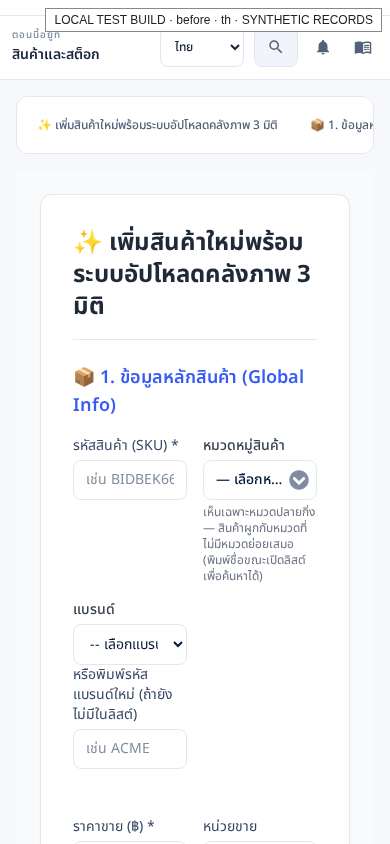
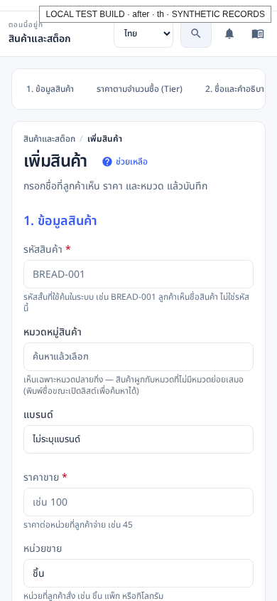

# Admin layout and form review

Validated 9 October 2026. Source: `faa9d99a44c786e3d9209e9b48af519fb156405d`; before: current master `a45eaa7c210ed8ce931d869d3096c17be7759c99`. The subsequent evidence commit only changes this report, screenshots and portable screenshot filenames.

Inherited Josh pages added their own outer padding, centered containers and resets inside the shared admin shell. The product form added another padded card and decorative steps. This caused inconsistent alignment and excessive gaps; several filters also overflowed on phones.

The migrated pages now share one outer spacing layer. Editor panels retain one responsive padding layer, and headers, tables and statistics use the shared UI tokens. The scoped legacy reset sits below shared utilities so it cannot erase input, dialog or panel borders. Product sections and tier-price fields avoid duplicate padding and headings. Order filters, notification filters and workflow settings wrap on phones.

Form follow-ups preserve each mounted form's dirty state separately, mark mouse picker selections as edits, allow a focused picker to reopen, and validate required picks against the selected record rather than typed search text. Optional product brands can be cleared. All 21 legacy editor save callers now return an explicit result; failed saves retain leave protection. Saves completed in a separate confirmation dialog clear protection only after completion. Segment guides match the existing freeze behavior in both languages.

## Validation

| Check | Result |
| --- | --- |
| Admin Vitest | 11 files, 167 tests passed |
| Portal Vitest | 3 files, 32 tests passed during shared UI review |
| Admin and portal TypeScript | Passed on final source |
| Admin production build | Passed on final source |
| Browser workflows | 10 checks passed: five each in Thai and English |
| Current management routes | 95: all 91 live `/j` routes plus four inherited marketing workflow routes |
| Current layout visits | 380: every route in both languages at 1440×1000 and 390×844 |
| Baseline layout visits | 40: ten representative routes in both languages and viewports |
| Layout findings after fixes | 0 blank/redirected pages, body overflow or root alignment issues |
| Browser page errors | 0 |
| Before/after screenshots | 92 |

Workflow checks cover optional brand selection/clearing; inline category creation with Enter saving exactly once; required commerce-owned warehouses; order UUID fallback, canceled close and failed save; failed research preserving text without a success toast; sidebar leave confirmation without a second native prompt; and failed legacy supplier saves retaining values and leave protection. Regression tests also cover multiple mounted forms and separately confirmed editor saves.

All browser API traffic uses intercepted synthetic fixtures. Unknown reads render unavailable/error states. No production API requests were sent. These checks verify rendering and the listed form interactions; they do not establish successful live Josh operations or visual approval of every populated record state. Browser Back remains outside the existing unsaved-changes guard. Native `FormPanel` handlers must still return `false` on failed saves; the stricter explicit-success contract applies to `AdminInsertLayout`.

## Before and after

| Screen | Before | After |
| --- | --- | --- |
| Product, Thai desktop | [Before](screenshots/before-th-product-create.png) | [After](screenshots/after-th-product-create.png) |
| Product, Thai phone | [Before](screenshots/before-th-layout-phone-product-create.png) | [After](screenshots/after-th-layout-phone-product-create.png) |
| Orders, Thai phone | [Before](screenshots/before-th-layout-phone-order.png) | [After](screenshots/after-th-layout-phone-order.png) |
| Supplier, English phone | [Before](screenshots/before-en-layout-phone-supplier-create.png) | [After](screenshots/after-en-layout-phone-supplier-create.png) |
| Workflow, English desktop | [Before](screenshots/before-en-layout-desktop-bot-workflows-edit-record.png) | [After](screenshots/after-en-layout-desktop-bot-workflows-edit-record.png) |

### Product on a phone

Before:



After:



[Workflow results](validation.json), [all route metrics](layout-results.json) and [captured images](screenshots/) contain the full evidence.

## Reproduce

Build both revisions with `VITE_COMMERCE_API=/api`, then run the review from the repository root:

```sh
node node_modules/vitest/vitest.mjs run --config apps/commerce-admin/vite.config.mts --maxWorkers=2
node node_modules/typescript/bin/tsc --noEmit -p apps/commerce-admin/tsconfig.app.json
node node_modules/typescript/bin/tsc --noEmit -p apps/commerce-portal/tsconfig.app.json
VITE_COMMERCE_API=/api NX_DAEMON=false NX_ISOLATE_PLUGINS=false node node_modules/nx/dist/bin/nx.js build commerce-admin --parallel=1 --skip-nx-cache
UI_REVIEW_BEFORE=/path/to/master/dist/apps/commerce-admin UI_REVIEW_OUT=/tmp/pr88-review node apps/commerce-admin/e2e/usability-review.mjs
```

The runner uses Playwright's installed Chromium, or the executable specified by `PLAYWRIGHT_CHROMIUM_EXECUTABLE_PATH`.
